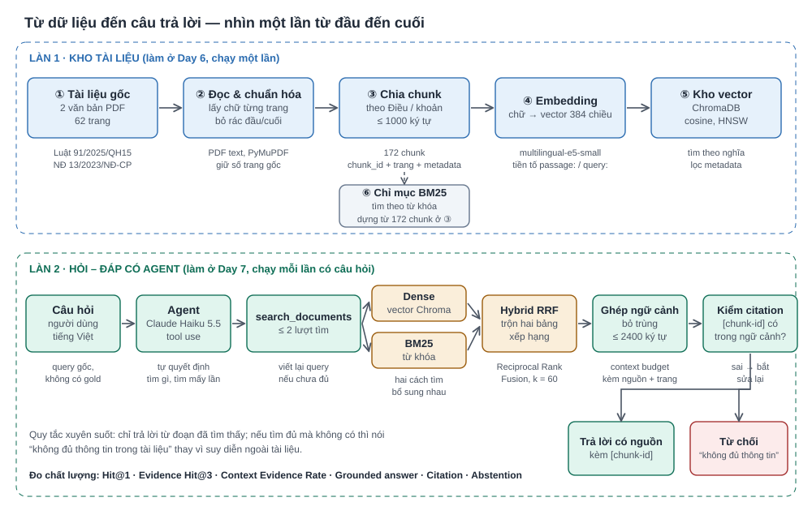
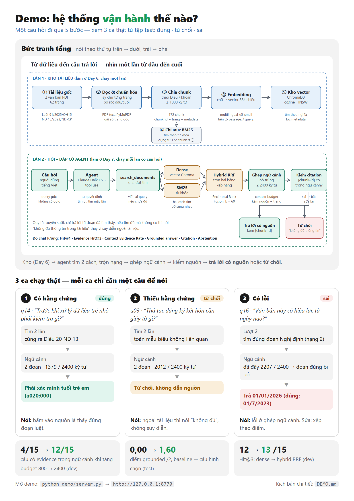
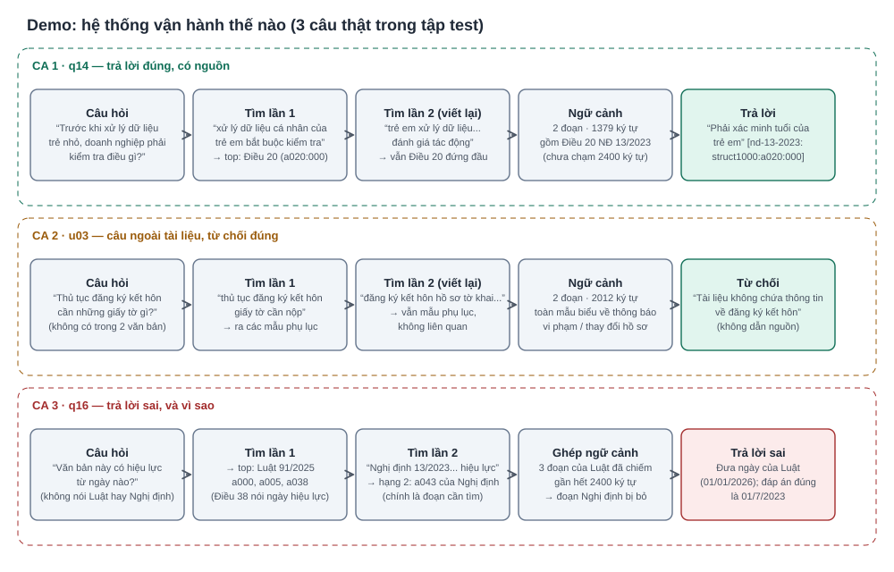

# Báo cáo Day 7 — Agent tra cứu luật dữ liệu cá nhân

> **Tôi cần làm trước khi nộp:** nhãn chấm (`results/audit/`) là bản nháp AI, tôi đọc lại 7 câu test rồi chốt.

## 0. Làm để làm gì
- **Bài toán:** tra nhanh Luật 91/2025/QH15 + Nghị định 13/2023 (62 trang).
- **Agent đứng giữa** người hỏi và kho văn bản: tìm đúng đoạn → trả lời **kèm nguồn** → thiếu thì nói "không đủ thông tin".
- **Nỗi đau:** tra tay lâu · AI trả lời không rõ nguồn · AI dễ trả lời cả khi tài liệu không có.

## Bước 1–3. Dữ liệu → xử lý → gắn vào
| Bước | Có gì |
|---|---|
| **1. Dữ liệu** | 2 PDF, 62 trang → **172 chunk** (Day 6). Benchmark **24 câu**: dev 15 có đáp án + 2 thiếu bằng chứng; test 5 + 2. Evidence đã kiểm khớp nguyên văn. |
| **2. Xử lý** | đọc PDF → chia chunk theo **Điều/khoản** (≤1000 ký tự) → embedding **e5-small** (384 chiều) → **ChromaDB**. Day 7 thêm **BM25**. |
| **3. Gắn vào** | Day 6 = kho; Day 7 = agent tra kho. Nối bằng **cùng chunk ID** (truy ngược trang) và **cùng embedding** (câu hỏi so được với tài liệu). |

## Bước 4. Kỹ thuật: làm gì · vì sao · tối ưu cho gì
| Kỹ thuật | Từ khóa | Vì sao dùng | Tối ưu cho |
|---|---|---|---|
| Chunk theo Điều | `structure chunking` | giữ trọn ý + ngoại lệ | đủ evidence |
| Embedding e5 đa ngữ | `query:` / `passage:` | hiểu tiếng Việt, tìm theo nghĩa | câu hỏi diễn đạt khác luật |
| ChromaDB | `cosine`, `HNSW` | có sẵn Day 6, ~28 ms | tốc độ |
| BM25 | `lexical` | khớp chính xác "72 giờ", "Mẫu số 03" | từ khóa, con số |
| **Hybrid RRF** | `k=60` | trộn **hạng** dense + BM25, khỏi chuẩn hóa điểm | đưa đúng đoạn lên top-3 |
| Context budget | `2400 ký tự` | model đọc có hạn, ký tự = chi phí | đủ evidence, không tốn thừa |
| Agent tool use | `claude-haiku-5-5`, ≤2 lượt tìm | tự viết lại query, tìm thêm | câu khó |
| Kiểm citation | `[chunk-id]` | chặn nguồn không có thật | tin cậy nguồn |
| Từ chối | `answerable=false` | ngoài tài liệu thì không trả lời | an toàn |

## Kết quả thử nghiệm
**CP3 (≥ 3 phương pháp, bắt buộc có dense): đạt, đã làm 4/6 phương pháp gợi ý.** Có: dense, lexical (BM25), hybrid (RRF), rerank (cross-encoder, làm sau khi đã chạy test nên chỉ đo trên dev). Có một phần, chưa đo riêng: query transformation (agent tự viết lại query ở lượt 2) và multi-stage (tối đa 2 lượt tìm).

**Retrieval, dev (query gốc, top-3):**
| Phương pháp | Hit@1 | Hit@3 |
|---|---|---|
| dense (baseline) | 8/15 | 12/15 |
| BM25 | 6/15 | 11/15 |
| **hybrid RRF** | **9/15** | **13/15** |

**Rerank trước/sau (dev, 15 câu, budget 2400):** lấy 20 candidate rồi xếp lại bằng `BAAI/bge-reranker-v2-m3`, lấy top-3.

| Phương pháp | Hit@1 trước → sau | Hit@3 trước → sau | Ngữ cảnh trước → sau |
|---|---|---|---|
| Dense | 8 → **12**/15 | 12 → **14**/15 | 12 → **13**/15 |
| BM25 | 6 → **12**/15 | 11 → **14**/15 | 10 → **13**/15 |
| Hybrid RRF | 9 → **12**/15 | 13 → **14**/15 | 12 → **13**/15 |

Cả 15 câu đều có evidence trong 20 candidate nên rerank có đủ nguyên liệu. Đổi lại là thời gian: cross-encoder chạy CPU, đo được 27–40 giây/câu khi máy chạy song song hai tiến trình nặng (cần đo lại lúc máy rảnh). Chưa chạy trên test, vì test đã dùng một lần để chốt `imp3`.

**Agent, dev — mỗi dòng đổi 1 yếu tố:**
| Cấu hình | Context có evidence | Từ chối nhầm | Token vào |
|---|---:|---:|---:|
| `base` dense · budget 800 | 4/15 | 11 | 70k |
| `imp1` hybrid · 800 | 4/15 | 10 | 75k |
| `imp2` hybrid · **2400** | **12/15** | 2 | 123k |
| `imp3` = imp2 + filter | **12/15** | 3 | 102k |
| `imp4` = imp2 + **rerank** (thử sau chốt test, chỉ dev) | 12/15 | 3 | 128k |

- **Rerank (imp4):** xếp lại tốt hơn ở retrieval (Hit@1 9 → 12/15) nhưng **không đổi** ở agent (evidence trong ngữ cảnh vẫn 12/15, vẫn thiếu q05, q07, q13). Token vào +25%; thời gian ~80 giây/câu khi máy chạy song song (cross-encoder chạy CPU). Giả thuyết: query agent viết lại làm lệch nên rerank không còn lợi; chưa kiểm chứng. Không chạy test để giữ nguyên quy trình (test đã dùng một lần cho `imp3`).
- **Cải thiện lớn nhất = tăng budget.** Chunk ~1000 ký tự không vừa 800 nên bị bỏ → agent không thấy evidence. Lên 2400: 4/15 → 12/15. Đổi lại token +75%.
- **Chọn `imp3`** theo tiêu chí ghi trước (`results/SELECTION_*.md`): hòa `imp2` → ít token hơn. **Lưu ý:** filter không kích hoạt ở câu nào, nên `imp3` ≈ `imp2`; chọn cái nào cũng được.
- **Lỗi dev còn lại:** `q07`, `q13` — đoạn đúng không vào top-3 ở cả 3 phương pháp (cần rerank/top-k lớn hơn).

## Bước 5. Demo (3 ca thật, tập test)
**Trang demo (1 trang, dùng để nói):** [`demo/demo-1-trang.png`](../../demo/demo-1-trang.png) · bản in [`.pdf`](../../demo/demo-1-trang.pdf)

- **`q14` đúng:** 2 lượt tìm → Điều 20 → "phải xác minh tuổi trẻ em" `[a020:000]`.
- **`u03` từ chối đúng:** hỏi đăng ký kết hôn → chỉ ra mẫu phụ lục không liên quan → "tài liệu không có".
- **`q16` sai:** câu mơ hồ ("văn bản này"). Đoạn Nghị định đúng đứng hạng 2 ở lượt hai nhưng **bị bỏ vì ngữ cảnh đã đầy** bởi 3 đoạn Luật. Sửa: xếp theo điểm thay vì thứ tự đến.

## Kết quả test (chạy 1 lần sau khi chốt)
| | Context có evidence | Grounded /2 | Citation hợp lệ | Từ chối đúng | Từ chối nhầm |
|---|---:|---:|---:|---:|---:|
| `base` | 0/5 | **0,00** | — | 2/2 | 5/5 |
| **`imp3`** | **4/5** | **1,60** | 5/7 | 2/2 | 0/5 |
| `imp4` (rerank, **xem sau khi chốt**) | 5/5 | 2,00 | 9/9 | 2/2 | 0/5 |

Token test: base 33k, imp3 57k. USD chưa tính (chưa có bảng giá xác minh).

**Rerank trên test (xem sau khi chốt, không dùng để đổi cấu hình):** `imp4` cho evidence trong ngữ cảnh 5/5 và grounded 2,00 (imp3: 4/5 và 1,60). Retrieval trên test gần như không đổi vì đã chạm trần (Hit@3 5/5 ở mọi phương pháp; chỉ BM25 Hit@1 3 → 4/5). Ở `q15` và `q16` agent với rerank trả lời cho cả hai văn bản nên đúng. Mỗi câu mất khoảng 50–60 giây (imp3 khoảng 5 giây) vì cross-encoder chạy CPU. Chỉ 5 câu, mỗi cấu hình một lần chạy, nhãn nháp AI: khác biệt có thể do dao động giữa các lần chạy.

## Giới hạn
- Nhãn là nháp AI, cần kiểm lại.
- Filter chưa kiểm chứng; mỗi cấu hình chạy 1 lần (có dao động).
- Test nhỏ, trùng test Day 6 (không dùng để chỉnh).
- Chưa thử rerank, multi-hop, prompt injection. Không làm thử thách nâng cao.

**Trace, nhãn, lệnh chạy:** `results/`, `RUN.md`.
